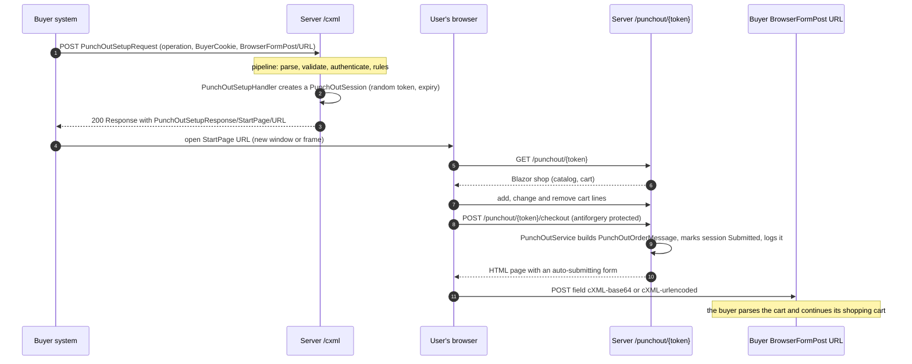
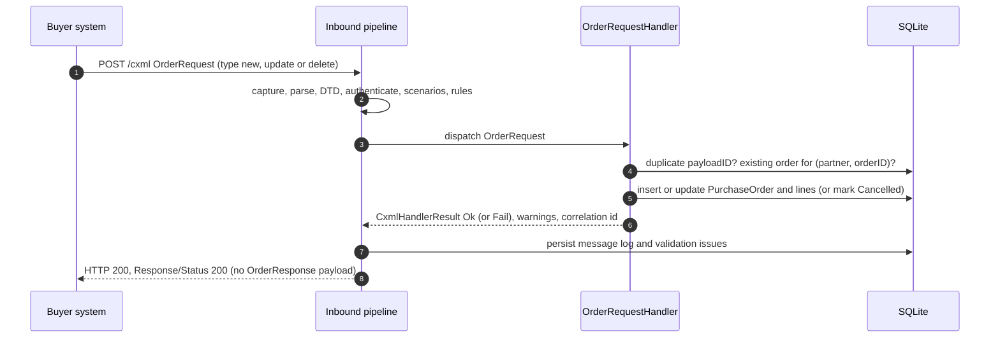
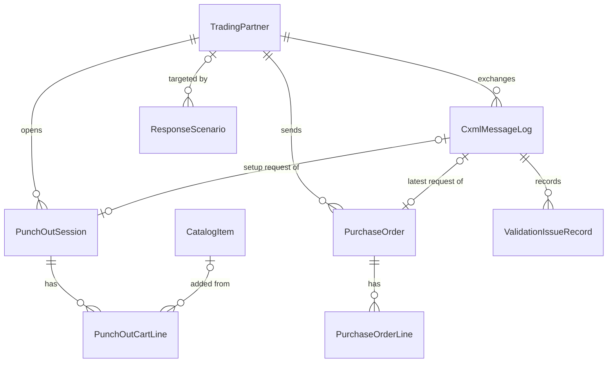

# Architecture

This document describes how the cXML Dev Server is put together: the layers, what happens to an inbound
document, how PunchOut and orders flow through the system, what is stored, and how validation,
authentication and logging work. Type and file names refer to the code in `src/`.

- [Layers and dependencies](#layers-and-dependencies)
- [The inbound pipeline](#the-inbound-pipeline)
- [HTTP status policy](#http-status-policy)
- [PunchOut flow](#punchout-flow)
- [OrderRequest flow](#orderrequest-flow)
- [Data model](#data-model)
- [Validation](#validation)
- [Authentication](#authentication)
- [Admin login, proxies and data protection](#admin-login-proxies-and-data-protection)
- [Logging and correlation](#logging-and-correlation)

## Layers and dependencies

```
CxmlDevServer.Web  ->  CxmlDevServer.Infrastructure  ->  CxmlDevServer.Core  ->  Cxml.Protocol
 (host, UI)             (EF Core SQLite, outbound HTTP)   (domain, pipeline)      (cXML library)
```

Dependencies point in one direction only.

| Project | Responsibility | Depends on |
|---|---|---|
| `Cxml.Protocol` | Pure cXML library: envelope and payload models (`CxmlEnvelope`, `OrderRequest`, `PunchOutSetupRequest`, ...), `CxmlReader`, `CxmlWriter`, `CxmlDtdValidator` with the embedded DTDs, `PunchOutFormEncoder`, `CredentialMacCalculator`, status codes. No ASP.NET, no EF, no I/O. | nothing |
| `CxmlDevServer.Core` | Domain entities, the inbound pipeline (`CxmlInboundProcessor` and its steps), request handlers (`ICxmlRequestHandler`), business rules (`IDocumentRule`), PunchOut and catalog services, message templates, the test-buyer receiver (`PunchOutReturnReceiver`), `ICxmlOutboundClient`. Defines `ICxmlDbContext` (the persistence abstraction) but does not implement it. | Protocol |
| `CxmlDevServer.Infrastructure` | `CxmlDevDbContext` (EF Core 10, SQLite) and its migrations, `DatabaseInitializer` and seed data, `CxmlOutboundClient` on `IHttpClientFactory`. | Core |
| `CxmlDevServer.Web` | ASP.NET Core host: minimal-API endpoints (`/cxml`, PunchOut checkout, test buyer, health), the Blazor Server admin UI and the PunchOut shop. | Infrastructure |

The cXML library is usable on its own: the Core and Web layers add no cXML knowledge to it, they only
register payload parsers and writers. New transactions plug in through the seams described in
[extending.md](extending.md).

## The inbound pipeline

`POST /cxml` hands the raw body to `CxmlInboundProcessor`. The processor runs a chain of
`ICxmlPipelineStep`s over a shared `CxmlInboundContext`. Each step does its work and calls `next`, or
short-circuits by setting `context.Response` (for example with `context.Fail(code, detail)`) and not calling
`next`. Steps run in ascending `Order` (`CxmlPipelineOrder`):

| Order | Step | What it does |
|---|---|---|
| 0 | `FinalizeStep` | Wraps everything. After the chain returns it turns an unexpected exception into a cXML `500`, serializes the response and **persists the message log entry with all validation issues**. |
| 100 | `CaptureStep` | Creates the log entry (direction, channel, remote endpoint, time). Reads the body; if the request is a form post with a `cXML-base64` or `cXML-urlencoded` field, the document is decoded from it. Invalid base64 is answered with `406`. |
| 200 | `ParseStep` | Parses the XML with `CxmlReader` and records document type, `payloadID` and `inReplyTo` on the log. An empty or malformed body is answered with `406` and the line and position of the error. |
| 300 | `DtdValidateStep` | Validates the raw text against the DTD and **records the issues only**. Whether they are enforced depends on the partner, which is not known yet. |
| 400 | `AuthenticateStep` | Finds the trading partner from the `Sender` (then `From`) credential, checks the shared secret and the `To` identity. See [Authentication](#authentication). Failures are answered with `401` (or `403` for a disabled partner). |
| 500 | `ScenarioStep` | If an enabled [response scenario](#response-scenarios) matches, applies it (delay, forced status, malformed body, no answer) and short-circuits. A scenario therefore replaces the real processing, even for documents that would fail validation. It runs after authentication, so unknown senders still get `401`. |
| 600 | `RuleValidateStep` | Runs the `IDocumentRule`s that apply, then enforces the partner's validation mode: in **Strict** mode any DTD or rule error is answered with `406` and the list of issues. **Off** discards the DTD and rule issues. |
| 700 | `DispatchStep` | Looks up the `ICxmlRequestHandler` registered for the request element name and calls it. No handler: `450`. A `Response` posted to the endpoint is answered with `400`, a `Message` with `450`. |

Custom steps register with `AddPipelineStep<T>()` and pick any `Order`, for example
`CxmlPipelineOrder.Authenticate + 1` to run right after authentication.

The handler returns a `CxmlHandlerResult` (status code, optional text and detail, optional response payload,
correlation id, warnings). `DispatchStep` turns it into the response envelope; a payload is only attached to
2xx responses, as the cXML spec demands.

### HTTP status policy

The cXML specification (and the real networks) report outcomes in the `Status` element of the response, not
in the HTTP status line. The server follows that rule: **every cXML-level outcome is answered with HTTP 200**
and the cXML status in the body:

| Situation | HTTP | cXML `Status` |
|---|---|---|
| Processed | 200 | 200 (OK) |
| Malformed XML, empty body, bad form field, Strict validation failure | 200 | 406 |
| Unknown sender, wrong secret, wrong `To` in Strict mode | 200 | 401 |
| Disabled partner | 200 | 403 |
| Unsupported request or message, `source` operation | 200 | 450 |
| Strict mode only: order exists or version not newer / order unknown | 200 | 409 / 412 |
| Unexpected exception | 200 | 500 |

This matters for client testing: a buyer must read the `Status` code, not rely on HTTP.

**The one exception is the response scenario.** A scenario can set an explicit `HttpStatus` (for example 503
with a body), return a deliberately broken body, or drop the connection without answering
(`NoResponse`), because those are exactly the failures a client's transport layer has to handle. The
scenario's `HttpStatus` is applied by `ScenarioStep`; `CxmlEndpoints` writes it to the response. `GET /cxml`
is a ping that returns a `Response` with `Status 200`.

Responses use the content type `text/xml; charset="UTF-8"`, start with `<?xml` (no BOM, no leading
whitespace) and carry the DOCTYPE of the cXML 1.2.071 DTD.

### Response scenarios

A `ResponseScenario` matches on partner (any when empty), document type and an optional substring of the
request, ordered by priority. It can respond with a chosen cXML status, delay (and then pass through),
return a malformed body or never answer. `RemainingUses` limits it to the next N matches; the claim is an
atomic database update, so "fail the first 3 orders" stays exact under concurrent requests. See
[client-setup.md](client-setup.md#testing-error-handling-with-scenarios).

## PunchOut flow



Details:

- **Setup.** `PunchOutSetupHandler` supports `create`, `edit` and `inspect`; `source` is answered with `450`.
  `BuyerCookie` is required and echoed back unchanged. A `BrowserFormPost/URL` is required for `create` and
  `edit` (it must be an absolute http or https URL); an `inspect` session is read-only and has no return
  address. For `edit` and `inspect` the cart is rebuilt from the `ItemOut` elements: first by the
  `SupplierPartAuxiliaryId` cookie this server issued (`PunchOutCookies`), then by `SupplierPartID`; an item
  that is in neither is kept as an ad-hoc line (with a warning if it has no `ItemDetail`).
- **StartPage.** The URL is `{base}/punchout/{token}` where `{base}` is `Cxml:PublicBaseUrl` or, when empty,
  the scheme and host of the request. The token is 32 random bytes (URL-safe base64). A session lives
  `Cxml:PunchOutSessionMinutes` minutes; it moves from `Created` to `Opened` on the first visit and may be
  reloaded until it is submitted, cancelled or expired.
- **Checkout.** `PunchOutEndpoints` validates the antiforgery token, serializes checkouts per session (a double
  click cannot return the cart twice) and calls `PunchOutService.CheckoutAsync`. The
  `PunchOutOrderMessage` is built by `PunchOutOrderMessageBuilder`: `From` is the default supplier identity,
  `To` the buyer's `From` credential, `Message@inReplyTo` the setup `payloadID`, `operationAllowed` the
  partner's setting, each line an `ItemIn` with `ItemDetail` and a UNSPSC `Classification`, and `Total` the
  sum of the lines. Credentials of a `PunchOutOrderMessage` are never trusted by the buyer, so the server
  puts no shared secret in it.
- **Return encoding.** The page carries one hidden field. The trading partner decides which one:
  `Base64` (field `cXML-base64`, the default) or `UrlEncoded` (field `cXML-urlencoded`, the XML escaped for
  an HTML attribute, with character references for non-ASCII; the server does not additionally URL-encode it).
- **Cancel.** `POST /punchout/{token}/cancel` returns an empty cart for `create`, or the original items with
  `Status 204` for `edit`. An inspect session has no return address and is just closed.
- **Test buyer.** If the `BrowserFormPost` URL is `/test-buyer/punchout-return`, `PunchOutReturnReceiver`
  plays the buyer: it decodes the field (base64 first), validates against the DTD, matches the session by
  `inReplyTo` (else `BuyerCookie`), logs the message (channel `BrowserPost`) and renders a summary.

## OrderRequest flow



cXML has no `OrderResponse` element: the reply to an `OrderRequest` is a bare `Response` with
`Status 200`. `OrderRequestHandler` decides as follows:

| Case | Lenient | Strict |
|---|---|---|
| `orderID` empty | 400 | 406 (the `RULE-ORDERID-PRESENT` error rejects it first) |
| No `ItemOut` (except `delete`) | 400 | 406 (the DTD requires `ItemOut`) |
| Same `payloadID` already processed successfully | 200 with a `ORDER-DUPLICATE-PAYLOAD` warning, nothing changes | same |
| `new` for an existing `orderID` | 200, order replaced, warning `ORDER-EXISTS` | 409 |
| `update` for an unknown order | 200, order created, warning `ORDER-UNKNOWN` | 412 |
| `delete` for an unknown order | 200, warning `ORDER-UNKNOWN` | 412 |
| `update` or `delete` with `orderVersion` not higher than the stored one | 200, warning `ORDER-VERSION-NOT-NEWER` | 409 |

A successful `new` stores the order as `Received`, an `update` (or a replaced order) as `Updated` and a
`delete` as `Cancelled`. Lines are replaced on every update. Orders are identified by the pair
(trading partner, `orderID`).

## Data model

SQLite through EF Core; migrations live in `src/CxmlDevServer.Infrastructure/Migrations` and are applied at
startup (`Cxml:InitializeDatabaseOnStartup`). Address-like blobs (ship-to, bill-to, contacts, extrinsics)
are stored as JSON columns because the UI only displays them.



| Entity | Purpose |
|---|---|
| `TradingPartner` | A buyer/network the server accepts: `From`, `Sender` and optional `To` credentials, `SharedSecret`, `AuthMode` (SharedSecret or None), `ValidationMode` (Strict, Lenient, Off), `PunchOutPostEncoding` (Base64, UrlEncoded), `OperationAllowed`, optional expected `DeploymentMode`, `IsActive`. |
| `SupplierIdentity` | A `To` credential this server answers to; one is the default used in outbound headers. |
| `CatalogItem` | A product in the demo shop (part id, price, UoM, UNSPSC, manufacturer, lead time, category, image). |
| `PunchOutSession` | One shopping session: one-time `Token`, partner, `BuyerCookie`, operation, `BrowserFormPostUrl`, setup `payloadID`, status (Created, Opened, Submitted, Cancelled, Expired), expiry, original items (for cancelling an edit), correlation id. |
| `PunchOutCartLine` | A cart line (catalog reference or ad hoc) with quantity, price and classification. |
| `PurchaseOrder`, `PurchaseOrderLine` | A received order: id, version, type, status (Received, Updated, Cancelled, Rejected), total, JSON snapshots, lines, the log entry of the last request. |
| `CxmlMessageLog` | Every document: direction (Inbound or Outbound), channel (Http, BrowserPost, ManualSend), document type, `payloadID`, `inReplyTo`, correlation id, partner, remote endpoint, HTTP and cXML status, raw request and response, duration, applied scenario, notes. |
| `ValidationIssueRecord` | One finding of a message: severity, code, message, line and position, source (Dtd, Rule, Auth, Parse). |
| `ResponseScenario` | A rule for misbehaving on purpose (see above). |

## Validation

Validation has two layers and three modes.

### DTD validation

`CxmlDtdValidator` validates with `System.Xml` (`DtdProcessing.Parse`, `ValidationType.DTD`) against the
cXML 1.2.071 DTDs. They are linked into `Cxml.Protocol` from `cXML-spec/cXML_DTDs/1.2.071` as embedded
resources (`Cxml.Protocol.Dtds.1.2.071.*`), so nothing is ever fetched.

- **Embedded resolver.** `EmbeddedDtdResolver` maps `http(s)://xml.cxml.org/schemas/cXML/{version}/{file}.dtd`
  (case-insensitive: documents in the wild use `xml.cXML.org`) to the embedded file and refuses every other
  URL, so a document cannot make the server read files or call out. The DOCTYPE decides the DTD: `cXML.dtd`
  for PunchOut and orders, `Fulfill.dtd` for ConfirmationRequest and ShipNoticeRequest, and so on. An
  unknown version falls back to 1.2.071 with a warning (`CXML-DTD-VERSION-FALLBACK`).
- **No DOCTYPE.** The document is validated against `cXML.dtd` and a warning `CXML-DTD-NO-DOCTYPE` is
  recorded; the injected DOCTYPE does not shift reported line numbers.
- **Internal subsets are rejected** (`CXML-DTD-INTERNAL-SUBSET`), and entity expansion is limited.
- **The `.ANY` entity quirk.** The cXML DTDs declare extension hooks such as
  `<!ENTITY % Object.ANY '|xades:QualifyingProperties|...'>` and use them inside mixed-content groups.
  .NET's DTD parser rejects such a non-empty replacement ("must nest properly within markup declarations")
  and then fails every document. The resolver therefore inlines the replacement text of these `%...ANY;`
  entities into the DTD it serves, which yields the identical content model. Comments are blanked first so
  commented-out declarations are not picked up. The preprocessed DTD text is cached per resource, so the
  rewrite happens once per process.

### Business rules

`IDocumentRule`s check what a DTD cannot express. They are small classes (derive from `DocumentRuleBase`),
registered with `AddDocumentRule<T>()`, and listed on the **Validation rules** page:

| Code | Checks |
|---|---|
| `RULE-TIMESTAMP-FORMAT` | `yyyy-MM-ddTHH:mm:sszzz` with a numeric offset (a `Z` suffix is not allowed) |
| `RULE-PAYLOADID-PRESENT` | `payloadID` present and shaped like `datetime.pid.random@host` |
| `RULE-ORDERDATE-FORMAT` | `OrderRequestHeader@orderDate` is a cXML timestamp |
| `RULE-ORDERID-PRESENT` | `orderID` not empty; update/delete should carry `orderVersion` |
| `RULE-ORDER-TOTAL` | `Total` equals the sum of quantity x unit price (optionally plus tax and shipping) |
| `RULE-LINENUMBERS-UNIQUE` | `ItemOut@lineNumber` is unique |
| `RULE-CURRENCY-CODE`, `RULE-COUNTRY-CODE` | ISO 4217 and ISO 3166-1 codes |
| `RULE-BROWSERFORMPOST-URL` | absolute http(s) URL |
| `RULE-BUYERCOOKIE-NONEMPTY` | `BuyerCookie` not empty |
| `RULE-DEPLOYMENT-MODE` | `deploymentMode` matches the partner's expected mode (warning) |

A rule that throws is reported as a warning and never breaks the request.

### Modes

The mode is a property of the trading partner (`DefaultValidationMode` for unknown partners):

| Mode | DTD and rule errors |
|---|---|
| **Strict** | The request is rejected with `406` and the issues are listed in the `Status` detail. |
| **Lenient** (default) | The request is processed; all issues are recorded on the message log. |
| **Off** | DTD and rule issues are discarded (authentication issues are always kept). The `To` check is skipped. |

Strict mode also changes some handler decisions (see the order table above). Responses created by the
server are always DTD-valid, and the test suite asserts that.

## Authentication

`AuthenticateStep` follows the cXML model: the `Sender` credential proves who is calling, `From` names the
buyer organisation, `To` names the supplier.

1. **Find the partner.** `TradingPartnerMatcher` matches the `Sender` credential (domain and identity,
   case-insensitive) against each partner's `SenderDomain`/`SenderIdentity`; if several partners share a
   sender (a network sending for many buyers) the one whose `From` credential also matches wins. If no
   `Sender` matches, a `From` match is used (direct connections) and an info issue `AUTH-MATCHED-BY-FROM`
   is recorded.
2. **Unknown sender.** `401`, unless `Cxml:AllowUnknownPartners` is true; then the document is processed with a
   warning (`AUTH-UNKNOWN-PARTNER`) and the server default validation mode.
3. **Disabled partner.** `403`.
4. **Shared secret.** With `AuthMode = SharedSecret` the `SharedSecret` of the `Sender` credential must equal the
   partner's (fixed-time comparison). A missing or wrong secret is `401`. `AuthMode = None` skips the check.
5. **`To` identity.** One of the `To` credentials must be a supplier identity (or the partner's `To` override).
   A mismatch is `401` in Strict mode, a warning in Lenient mode and ignored when validation is Off.
6. **`CredentialMac`.** The HMAC-SHA1-96 calculation is implemented (`CredentialMacCalculator`, verified with
   the specification's test vector) but not enforced: a MAC is accepted with a warning
   (`AUTH-MAC-NOT-VERIFIED`).

A `PunchOutOrderMessage` carries no trusted credentials; the buyer decides whom to believe.

## Admin login, proxies and data protection

The section above is about the *cXML sender*, who is authenticated per document. The browser-facing admin UI
has its own, separate and optional access control (settings in
[deployment/configuration.md](deployment/configuration.md)).

### Admin login

With `Admin:Enabled=false` (the default) nothing changes: the `Admin` authorization policy exists but lets
everybody in, so local runs and the tests need no login. With `Admin:Enabled=true`:

- **Cookie authentication** (`AdminAuthExtensions`): one account (`Admin:Username`) verified against
  `Admin:PasswordHash`, an ASP.NET Core Identity `PasswordHasher` hash produced by the `hash-password` command
  (or the plain `Admin:Password` fallback, compared in constant time). The user name and password are always
  both compared, so a failure does not say which was wrong. The cookie `cxml-dev-admin` is `HttpOnly`,
  `SameSite=Lax`, `Secure` when the request is HTTPS, with a sliding expiry of `Admin:SessionHours`.
- **Which pages**: every admin page carries `[Authorize(Policy = "Admin")]`; `Shop`, `NotFound`, `Error` and
  `Login` are `[AllowAnonymous]`. `Routes.razor` uses `AuthorizeRouteView`; an unauthorized visitor gets
  `RedirectToLogin`, a forced page load to `/login?returnUrl=...` (a `302` for a first request). The
  Blazor hub (`/_blazor`) stays reachable and authorization is enforced per component, so an anonymous
  circuit can render only the anonymous pages.
- **What stays open, with no authorization at all**: the minimal-API endpoints `/cxml`, `/punchout/*`
  (checkout and cancel), `/test-buyer/*` and `/health`, plus static assets. Buyer systems authenticate there
  with the cXML credentials (see above), and the shop is protected by its random session token.
- **Login page and endpoint**: `/login` is static server rendering (`[ExcludeFromInteractiveRouting]`; `App.razor`
  picks the render mode with `HttpContext.AcceptsInteractiveRouting()`) and posts a form to
  `POST /account/login`. That endpoint validates the antiforgery token, is rate limited (fixed window, 5
  attempts per minute and client address, then `429`) and redirects only to local return URLs.
  `POST /account/logout` clears the cookie.
- **Microsoft 365 sign-in** (optional, `Admin:Microsoft:*`, independent of the password): the stock
  ASP.NET Core OpenID Connect handler is registered as the scheme `Microsoft` (always registered; configured
  from `AdminOptions` through options) against the tenant-specific authority
  `https://login.microsoftonline.com/{tenantId}/v2.0`, with the authorization code flow and PKCE, scopes
  `openid profile email` and `prompt=select_account`. It signs into the **existing cookie scheme**, so the
  `Admin` policy, `AuthorizeRouteView` and the sidebar work unchanged. `POST /account/login/microsoft` (antiforgery
  protected, same rate limit as the password login, return URL through `ReturnUrls.Sanitize`) starts the
  challenge. The callback `/signin-oidc` is handled by the authentication middleware, before endpoint routing, and
  is anonymous by nature. The issuer must be the tenant's, and `OnTokenValidated` additionally requires the `tid`
  claim to equal the configured tenant id (`MicrosoftClaims.CreatePrincipal`); the cookie gets a slim principal
  (name from `preferred_username`, `oid`, `tid`, `name`, and `cxml_auth=microsoft`; `cxml_auth=password` for the
  password login). No tokens are stored. Any remote failure (cancel, bad state, wrong tenant) redirects to
  `/login?error=sso` and logs only an exception type. Sign-out is local: the Microsoft session is not ended.
  Without Microsoft settings the scheme gets placeholder options (the handler validates them on every request)
  and is never challenged.
- **Fail fast**: `AdminOptions` is validated at start-up. An enabled login without any sign-in method (password
  hash/password or the complete Microsoft settings), a bad hash, or a Microsoft tenant that is not a single GUID
  stops the application with a message, so it never runs open by accident.

### Reverse proxies and forwarded headers

The deployments run the container behind a TLS-terminating proxy (Azure Container Apps ingress, Caddy), so
the application sees plain HTTP. `ASPNETCORE_FORWARDEDHEADERS_ENABLED=true` (set in the image) makes the
default host add the forwarded headers middleware for `X-Forwarded-For` and `X-Forwarded-Proto` with the known
proxy networks cleared. Consequences:

- `Request.Scheme` is `https`, so the `StartPage` URL, which `PunchOutSetupHandler` builds from the request
  base URL, and the `Secure` flag of the login cookie are right. `X-Forwarded-Host` is **not** processed: the
  proxy must keep the original `Host` header, otherwise set `Cxml:PublicBaseUrl`, which always wins over the
  request-derived base URL (`CxmlServerOptions.ResolveBaseUrl`).
- The client address in logs, in the message log and in the login rate limiter is the forwarded one.
- Because any peer is trusted, the application port must only be reachable from the proxy; otherwise a client
  could forge its address and scheme.

### Data Protection keys

Antiforgery tokens (the login form, the PunchOut checkout), the login cookie and Blazor circuit state use
ASP.NET Core Data Protection. `DataProtectionSetup` stores the keys in `DataProtection:KeysPath` (default: a
`keys` folder next to the SQLite file, `/app/data/keys` in the image) under the fixed application name
`CxmlDevServer`, so they survive restarts when the data does. An empty `KeysPath` keeps them in memory (a
warning is logged) and every restart then signs everybody out and invalidates open forms. On Azure Container
Apps the folder is part of the ephemeral volume, so administrators sign in again after each restart.

## Logging and correlation

- **Message log.** Every document is stored by `FinalizeStep` (inbound, channel `Http`), `PunchOutService`
  (outbound `PunchOutOrderMessage`, channel `BrowserPost`), `PunchOutReturnReceiver` (the test buyer, inbound
  `BrowserPost`) and `CxmlOutboundClient` (the message sender, channel `ManualSend`), each with raw text,
  response, status, duration and issues. Rejected and failed requests are logged too, which is the whole
  point for debugging.
- **Correlation id.** Related messages share a `CorrelationId` so the inspector can show them together:
  one PunchOut session (a GUID created with the session; the setup request, the outbound order message and
  the test-buyer receipt all carry it) or one order (`order:{partnerId}:{orderId}`, for every version).
  A handler sets it through `CxmlHandlerResult.CorrelationId`. `payloadID` and `inReplyTo` are stored as
  well.
- **Application logging.** Standard `Microsoft.Extensions.Logging` to the console. Unexpected exceptions are
  logged with their stack trace and also stored in the `Notes` of the message log entry. EF Core and
  ASP.NET Core are set to `Warning` in `appsettings.json`.
- **Failure isolation.** A handler that fails after a partial database change cannot leak that state: the
  change tracker is cleared before the 500 response and its log entry are written.
