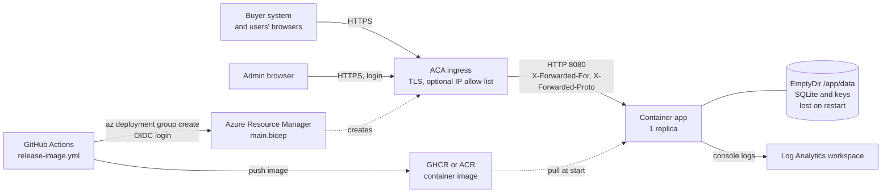
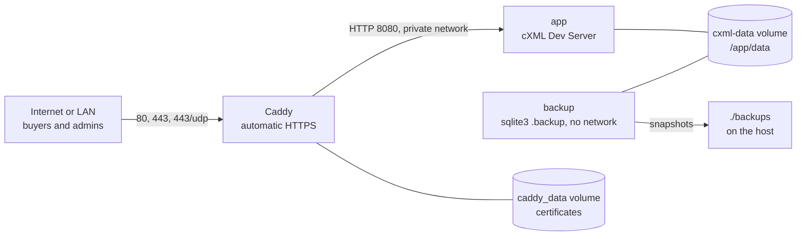

# Deploying the cXML Dev Server

The server is a single container (ASP.NET Core with an embedded SQLite database) that buyer-side teams
use as a stand-in for a supplier. This folder explains how to run it for **shared use** by procurement
and integration teams, as opposed to the single-user `dotnet run` described in the
[README](../../README.md).

Two ready-made deployments live in this repository:

| Deployment | Where | Files |
|---|---|---|
| **Azure Container Apps** (ACA) | A managed container service in your Azure subscription | [`deploy/azure`](../../deploy/azure) (Bicep), [`.github/workflows/deploy-aca.yml`](../../.github/workflows/deploy-aca.yml) |
| **Self-hosted Docker Compose** | Any Linux host with Docker: Caddy (automatic HTTPS) + app + SQLite backups | [`deploy/selfhost`](../../deploy/selfhost) |

- [Choosing a deployment](#choosing-a-deployment)
- [Architecture](#architecture)
- [What every environment needs](#what-every-environment-needs)
- [The documents in this folder](#the-documents-in-this-folder)
- [What is and is not tested](#what-is-and-is-not-tested)

## Choosing a deployment

| | Local development | Self-hosted Compose | Azure Container Apps |
|---|---|---|---|
| Typical use | One developer, one machine | A team or company network, a small VM or on-premises server | A team that already uses Azure and wants no server to patch |
| Start command | `dotnet run` or the root [`docker-compose.yml`](../../docker-compose.yml) | `docker compose up -d` in `deploy/selfhost` | `az deployment group create` or the GitHub workflow |
| **Data persistence** | SQLite file on disk or a Docker volume | **Persistent** Docker volume plus scheduled SQLite backups | **Ephemeral**: the database is recreated on every restart, new revision or deployment |
| TLS | none (plain http on localhost) | Automatic Let's Encrypt certificate via Caddy, or Caddy's own CA for a LAN | Provided by the platform (`*.azurecontainerapps.io`), managed certificate for a custom domain |
| Admin login | off by default | on (required by the compose file) | on by default in the template |
| Cost | none | The host you already have; a 1 vCPU / 1 GB VM is enough | Pay per use of one always-on replica plus Log Analytics ingestion; see the Azure pricing calculator |
| Effort to stand up | minutes | about 30 minutes (DNS, firewall, `.env`) | about 1 hour the first time (Entra app, role assignment, GitHub secrets), then one command or one manual workflow run |
| Effort to operate | none | Docker updates, host patching, backup checks | Almost none; re-enter partners after every restart (see below) |
| Best for | Developing against the simulator, running the tests | Long-lived shared environment where configured partners and the message history must survive | Disposable, quickly provisioned shared environment, demos, workshops, CI-style integration tests |

Rule of thumb: if people configure trading partners by hand and expect them to still be there next week,
use **self-hosted**. If the environment can be thrown away and recreated (or you accept re-entering a few
partners), **Azure Container Apps** needs the least operations work.

> **Ephemeral on Azure.** The ACA template stores SQLite on an `EmptyDir` volume by design. Everything you
> configure in the admin UI (partners, identities, catalog edits, scenarios) and everything the server
> records (message log, orders, PunchOut sessions) is lost when the container restarts, is moved, or when a
> new revision is created, which includes every deployment. Read
> [the data implications](azure-container-apps.md#ephemeral-data-and-what-to-do-about-it) before choosing it.

## Architecture

### Azure Container Apps

### Self-hosted

In both cases a reverse proxy terminates TLS and the application only ever sees plain HTTP on port 8080.
The image therefore honours `X-Forwarded-For` and `X-Forwarded-Proto`
(`ASPNETCORE_FORWARDEDHEADERS_ENABLED=true`), so the PunchOut `StartPage` URLs it creates are `https://`.
Never publish port 8080 directly to the internet: any client could then spoof those headers. See
[forwarded headers and PublicBaseUrl](configuration.md#forwarded-headers-and-publicbaseurl).

## What every environment needs

Whatever the platform, a working shared environment has these ingredients:

1. **The image**: `ghcr.io/mthpbs/cxml-dev-server:<tag>` (published by `release-image.yml`: semver and `latest` on `v*` tags, `edge` on main), another registry
   you push to, or built from this repository with `docker build`. Prefer an immutable tag (`v1.2.0`,
   `sha-abc1234`) over `latest`.
2. **An admin password hash** in `Admin__PasswordHash`, created with the image's `hash-password` command.
   The admin UI is open to everyone until `Admin__Enabled=true`; the application refuses to start with the
   login enabled and no password.
3. **A stable public HTTPS URL** that buyer systems and users' browsers can reach. Set
   `Cxml__PublicBaseUrl` whenever the proxy does not pass the original host through unchanged.
4. **A decision about demo data**: `Cxml__SeedDemoPartners=false` for anything reachable from a network you
   do not fully control, because the demo partners use the well-known secrets `devsecret` and `abracadabra`.
5. **Real trading partners with strong shared secrets**, created in the admin UI after the first start:
   follow the [new-environment checklist](configuration.md#new-environment-checklist).
6. **A way to see logs** (`docker compose logs`, `az containerapp logs show`, Log Analytics).
7. **A backup plan** if the data matters: automatic with the self-hosted stack, not possible on ACA (see
   above).

## The documents in this folder

| Document | Read it to |
|---|---|
| [azure-container-apps.md](azure-container-apps.md) | Set up the Azure side once, deploy with the CLI or the GitHub workflow, verify, operate and tear down |
| [self-hosted.md](self-hosted.md) | Prepare a host, bring up the Compose stack, run it on a LAN, upgrade, back up, restore |
| [configuration.md](configuration.md) | Look up every setting, see how secrets are handled, and work through the checklist for configuring a new environment |
| [../client-setup.md](../client-setup.md) | Give buyer teams their connection details and troubleshoot rejected requests |
| [../architecture.md](../architecture.md) | Understand authentication, forwarded headers and data protection inside the application |

## What is and is not tested

The repository's CI builds and tests the solution, builds the container image and runs `hash-password` in
it, compiles and lints the Bicep files, validates both Compose files and the Caddyfile, shell-checks the
backup script and lints the workflows. It cannot deploy to Azure: the Azure commands in
[azure-container-apps.md](azure-container-apps.md) follow the Azure CLI and Bicep documentation, were checked
against the template in this repository, and are marked where you should verify flags against your installed
`az` version.
